# Avaliação de modelos de Inteligência Artificial Generativa na detecção de defeitos em requisitos de software

Repositório do Trabalho de Conclusão de Curso de **Julia Lopes**, Bacharelado em Engenharia de Software da Universidade da Região de Joinville (Univille), sob orientação da **Prof.ª Chaiene Mercedes da Silva Minella** (2026).

**Pergunta de pesquisa:** como três modelos de Inteligência Artificial Generativa (ChatGPT, Claude e Gemini) se comportam na detecção e classificação de defeitos em requisitos de software?

Este repositório reúne tudo o que foi feito para montar o experimento: de onde vieram os requisitos, como os projetos foram escolhidos, como os defeitos foram inseridos e validados, as instruções (*prompts*) usadas, a planilha completa e scripts que recalculam os números. A ideia é que qualquer pessoa consiga refazer cada passo.

> **Situação em 18/11/2026:** a base de requisitos e o gabarito estão prontos. Os testes de detecção (seção 9) ainda não foram realizados.

---

## Visão geral

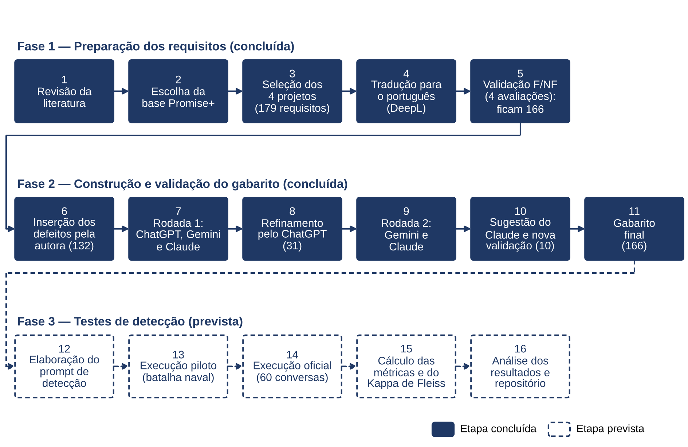

Caixas cheias são etapas concluídas; caixas tracejadas são etapas previstas. É a mesma figura usada no TCC. O caminho de cada requisito na validação dos defeitos, com as quantidades de cada rodada, está na seção 8.

## Sumário

1. [Estrutura do repositório](#1-estrutura-do-repositório)
2. [De onde vieram os requisitos](#2-de-onde-vieram-os-requisitos)
3. [Preparação da planilha](#3-preparação-da-planilha)
4. [Seleção dos projetos](#4-seleção-dos-projetos)
5. [Confirmação dos requisitos funcionais](#5-confirmação-dos-requisitos-funcionais)
6. [Tradução](#6-tradução)
7. [Inserção dos defeitos](#7-inserção-dos-defeitos)
8. [Validação dos defeitos pelas IAs](#8-validação-dos-defeitos-pelas-ias)
9. [Testes de detecção (a realizar)](#9-testes-de-detecção-a-realizar)
10. [Dicionário de colunas da planilha](#10-dicionário-de-colunas-da-planilha)
11. [Como reproduzir](#11-como-reproduzir)
12. [Uso de Inteligência Artificial](#12-uso-de-inteligência-artificial)
13. [Histórico das principais decisões](#13-histórico-das-principais-decisões)
14. [Referências e licença dos dados](#14-referências-e-licença-dos-dados)

---

## 1. Estrutura do repositório

```
tcc/
├── README.md                          este passo a passo
├── dados/
│   ├── Promise+.arff                  arquivo original da base Promise+ (sem alteração)
│   ├── LEIA-ME.md                     origem, licença e conferência do arquivo
│   ├── planilha_do_experimento.xlsx   planilha completa (MVP do TCC)
│   └── gabarito_166_requisitos.csv    resumo do gabarito, fácil de abrir no navegador
├── prompts/
│   ├── 01_classificacao_funcional_nao_funcional.md
│   ├── 02_validacao_erros_rodada1.md
│   ├── 03_validacao_refinamentos_rodada2.md
│   └── 04_validacao_sugestoes_claude.md
├── scripts/
│   ├── funil_selecao.py               refaz a seleção dos projetos a partir do .arff
│   └── conferir_numeros.py            recalcula os números a partir da planilha
└── imagens/                           fluxos, gráficos e prints da planilha
```

---

## 2. De onde vieram os requisitos

Os requisitos vêm da **Promise+**, uma base pública brasileira de requisitos de software apresentada no Simpósio Brasileiro de Engenharia de Software de 2024 (SILVA et al., 2024). Ela amplia a antiga PROMISE_exp com requisitos tirados de documentos de especificação da base PURE e classifica cada requisito como funcional ou em uma das classes de requisito não funcional.

| Item | Valor |
| --- | --- |
| Arquivo | `Promise+.arff`, versão v1 de 24/07/2024 |
| Onde baixar | Zenodo, DOI [10.5281/zenodo.12805484](https://doi.org/10.5281/zenodo.12805484) |
| Licença | CC BY 4.0 (uso livre com atribuição) |
| Conteúdo | 3.677 requisitos de 88 projetos: 2.258 funcionais e 1.419 não funcionais |
| Conferência | MD5 `f9227908ff871ccf9a30f53aa61c921a` |

O arquivo está no formato ARFF: um cabeçalho de 9 linhas e, depois de `@DATA`, uma linha por requisito com o número do projeto, o texto entre aspas simples e a classe.

```
@RELATION nfr
@ATTRIBUTE ProjectID {1,2,3,...,91}
@ATTRIBUTE RequirementText string
@ATTRIBUTE _class_ {F,A,L,LF,MN,O,PE,SC,SE,US,FT,PO}
...
@DATA
1,'The system shall refresh the display every 60 seconds.'PE
1,'The system shall provide a history report of changes made to the Activity or Event data'F
```

As classes seguem a convenção da PROMISE: **F** é funcional, e as demais são tipos de requisito não funcional.

| Classe | Significado | Classe | Significado |
| --- | --- | --- | --- |
| F | Funcional | O | Operacional |
| A | Disponibilidade | PE | Desempenho |
| FT | Tolerância a falhas | PO | Portabilidade |
| L | Legal | SC | Escalabilidade |
| LF | Aparência (*look and feel*) | SE | Segurança |
| MN | Manutenibilidade | US | Usabilidade |

O cabeçalho cita os projetos 41 e 91, mas nenhum requisito usa esses números, e o projeto 44 não existe. Por isso a base tem 88 projetos, e não 91.

---

## 3. Preparação da planilha

O arquivo `.arff` foi colado, sem alteração, na primeira aba da planilha (**REQUISITOS BASE**). Na segunda aba (**APENAS FUNCIONAIS**), cada linha recebe a linha original na coluna A, e fórmulas separam os campos:

| Coluna | Conteúdo | Fórmula (linha 2) |
| --- | --- | --- |
| B | Projeto | `=VALUE(LEFT(A2,FIND(",",A2)-1))` |
| C | Texto do requisito | `=MID(A2,FIND("'",A2)+1,FIND(CHAR(1),SUBSTITUTE(A2,"'",CHAR(1),LEN(A2)-LEN(SUBSTITUTE(A2,"'",""))))-FIND("'",A2)-1)` |
| D | Classe original | `=TRIM(SUBSTITUTE(MID(A2,FIND(CHAR(1),SUBSTITUTE(A2,"'",CHAR(1),LEN(A2)-LEN(SUBSTITUTE(A2,"'",""))))+1,10),",",""))` |
| E | Número de palavras | `=IF(TRIM(C2)="",0,LEN(TRIM(C2))-LEN(SUBSTITUTE(TRIM(C2)," ",""))+1)` |

As fórmulas estão na notação do Excel em inglês; no Excel em português, os nomes das funções aparecem traduzidos (por exemplo, `PROCURAR` no lugar de `FIND`) e o separador é o ponto e vírgula. A fórmula da coluna C procura a **última** aspa da linha, porque alguns textos têm vírgulas e pontos internos. As duas abas têm exatamente os mesmos 3.677 requisitos, na mesma ordem. Na segunda aba, as 1.419 linhas não funcionais estão ocultas, e não apagadas.

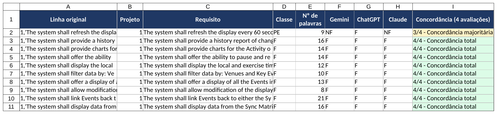

---

## 4. Seleção dos projetos

O objetivo era um conjunto entre 100 e 200 requisitos, formado por **projetos inteiros** (sem sortear requisitos soltos), escritos como obrigação, de tamanho moderado e fáceis de entender sem conhecimento técnico do domínio. Os critérios foram aplicados em sequência:

| Etapa | Critério | Projetos restantes |
| --- | --- | --- |
| — | Projetos da Promise+ | 88 |
| 1 | Pelo menos 35 requisitos funcionais | 21 |
| 2 | Pelo menos 90% dos funcionais com verbo de obrigação (*shall*, *must*, *should* ou *will*) | 16 |
| 3 | Média de até 25 palavras por requisito | 12 |
| 4 | Sem projeto duplicado (o 46 é cópia do 67) nem documento em rascunho (85) | 10 |
| 5 | Domínio de conhecimento geral | 4 |

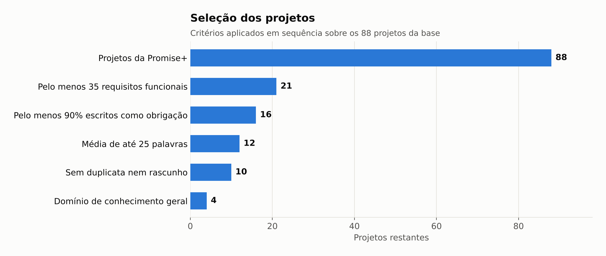

As etapas 1 a 3 são automáticas e podem ser refeitas com `scripts/funil_selecao.py`. As etapas 4 e 5 foram feitas pela leitura dos requisitos. Na etapa 5 saíram seis projetos de domínio técnico ou regulatório: controle de tráfego (55), gestão de pontes (63), sinalização ferroviária (68), dados de tráfego para órgão de transporte (70), produtos de dados de satélite (71) e compras públicas eletrônicas (82).

Restaram quatro projetos. A Promise+ identifica os projetos só por número; os nomes abaixo foram atribuídos pela autora a partir do conteúdo de cada um.

| Projeto | Assunto | Requisitos funcionais |
| --- | --- | --- |
| 5 | Busca de oficina e orçamento de reparo | 36 |
| 10 | Jogo de batalha naval | 38 |
| 61 | Gestão de creche | 43 |
| 67 | Loja virtual | 62 |
| | **Total** | **179** |

Ficaram perto do corte o projeto 3 (laboratórios clínicos de enfermagem, com média de 25,1 palavras) e o 45 (agendamento de reuniões, com 32 funcionais).

---

## 5. Confirmação dos requisitos funcionais

Como o experimento usa apenas requisitos funcionais, a classificação da Promise+ foi conferida por três IAs. Cada uma classificou os **3.677 requisitos da base inteira** como funcional (F) ou não funcional (NF), em conversas separadas e com a mesma instrução: [prompt 1](prompts/01_classificacao_funcional_nao_funcional.md). A instrução pedia que cada IA ignorasse as classificações já registradas na planilha.

| Avaliação | Funcionais (F) | Não funcionais (NF) |
| --- | --- | --- |
| Promise+ (classificação original) | 2.258 | 1.419 |
| Gemini | 2.092 | 1.585 |
| ChatGPT | 3.203 | 474 |
| Claude | 2.197 | 1.480 |

A coluna I da aba APENAS FUNCIONAIS compara as quatro avaliações por fórmula e pinta o resultado:

```
=IF(OR(F2="",G2="",H2=""),"Pendente",
  IF(AND(IF(D2="F","F","NF")=F2,F2=G2,G2=H2),"4/4 - Concordância total",
  IF(OR(COUNTIF(F2:H2,"F")+IF(D2="F",1,0)=3,COUNTIF(F2:H2,"NF")+IF(D2<>"F",1,0)=3),
     "3/4 - Concordância majoritária","2/4 - Sem consenso")))
```

Na base inteira, as quatro avaliações coincidiram em 2.192 requisitos, três coincidiram em 1.116 e houve empate em 369.

**Regra adotada:** nos quatro projetos, ficou apenas o requisito que as **quatro** avaliações classificaram como funcional. Saíram 13 dos 179, e o conjunto ficou com **166 requisitos**.

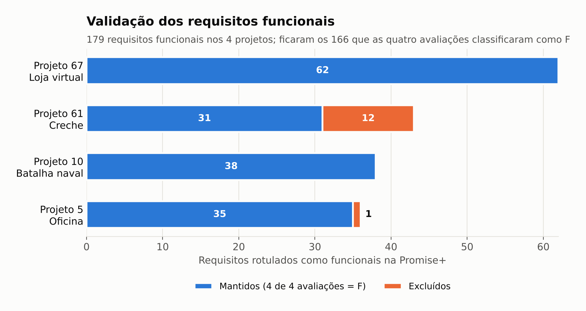

<details>
<summary>Os 13 requisitos excluídos</summary>

| Projeto | Requisito (original) | Gemini | ChatGPT | Claude | Concordância |
| --- | --- | --- | --- | --- | --- |
| 5 | The audit report shall be available to other adjusters at later points in time. | NF | NF | F | 2/4 |
| 61 | The Parent s record shall contain the following information: Name, Address, Home phone, Work phone, Email address, Emergency contact, Name of an authorized pick up. | F | NF | F | 3/4 |
| 61 | The system shall have a Web based interface that works with Internet Explorer and Netscape Navigator. | NF | F | NF | 2/4 |
| 61 | The background color of all windows shall be blue. | NF | NF | NF | 3/4 |
| 61 | The system shall respond to all user requests within 20 seconds. | NF | NF | NF | 3/4 |
| 61 | There shall be two levels of access; one for teachers and assistants and one for administrators. | F | F | NF | 3/4 |
| 61 | The teachers and assistants shall only be allowed to enter or edit child comments and child arrival or departure times. | F | F | NF | 3/4 |
| 61 | The administrators shall be allowed to enter or edit all data. | F | F | NF | 3/4 |
| 61 | Only the administrators shall be allowed to view or print reports. | F | F | NF | 3/4 |
| 61 | All employees shall be allowed to use the Daily Reminders. | F | F | NF | 3/4 |
| 61 | Only the administrators shall be allowed to view or print invoices. | F | F | NF | 3/4 |
| 61 | All invoices shall be available for printing at the end of each month. | NF | NF | F | 2/4 |
| 61 | Itemized customer invoices showing amount due shall be available for printing. | NF | NF | F | 2/4 |

Em todos eles, a classificação original da Promise+ era F. Seis requisitos de permissão de acesso saíram porque apenas o Claude os classificou como não funcionais.

</details>

---

## 6. Tradução

Os 179 requisitos dos quatro projetos foram traduzidos para o português com o DeepL, que não é um dos modelos avaliados. O texto traduzido foi mantido como saiu, inclusive o verbo de obrigação, que aparece ora como "deve", ora como "deverá".

---

## 7. Inserção dos defeitos

Os defeitos foram inseridos manualmente pela autora, na coluna F da aba REQUISITOS DO TCC, em quatro categorias. Cada uma corresponde a uma característica de qualidade da norma ISO/IEC/IEEE 29148:2018.

| Categoria | Característica da ISO/IEC/IEEE 29148 | Como o defeito foi inserido |
| --- | --- | --- |
| Ambiguidade | Não ambíguo (5.2.5, p. 12) e critérios de linguagem (5.2.7, p. 14) | Troca por um termo vago ou uso de pronome com mais de um referente |
| Incompletude | Completo (5.2.5, p. 12) | Retirada de uma condição, de um ator ou de um valor necessário |
| Inviabilidade | Viável (5.2.5, p. 13) | Acréscimo de uma exigência que o sistema não tem como cumprir |
| Redundância | Consistente, no conjunto (5.2.6, p. 13) | Repetição, no próprio requisito, de uma informação que ele já contém |

Quando um trecho pudesse caber em mais de uma categoria, valeu a regra de desempate: termo vago no lugar de uma informação é ambiguidade; informação ausente é incompletude; pedido claro e completo, mas impossível de cumprir, é inviabilidade.

Em cada projeto, os defeitos foram inseridos nos primeiros requisitos, com as categorias em rodízio, e os últimos 8 ou 9 ficaram sem defeito. O resultado foi **132 requisitos com defeito (33 por categoria) e 34 sem defeito**.

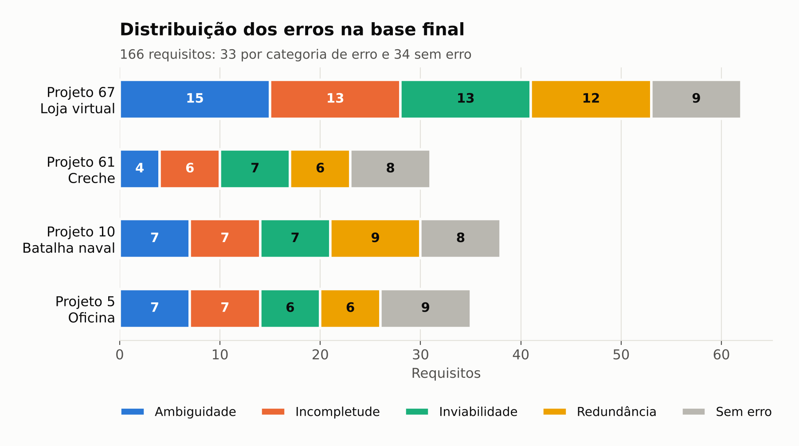

Exemplos tirados do texto final:

| Categoria | Requisito traduzido | Texto com defeito |
| --- | --- | --- |
| Ambiguidade | O sistema deverá exibir todas as promoções disponíveis ao usuário. | O sistema deve exibir as **principais** promoções disponíveis ao usuário. |
| Incompletude | As classificações deverão seguir uma escala de 1 a 10. | As classificações devem seguir uma escala. |
| Inviabilidade | Um professor e um assistente devem ser designados para cada turma. | Um professor e um assistente devem ser designados para cada turma**, e o sistema deve garantir que nenhum deles falte ao trabalho**. |
| Redundância | O produto deverá continuar a atribuir turnos até que o jogo seja encerrado. | O produto deverá continuar a atribuir turnos até que o jogo seja encerrado. **Enquanto o jogo não terminar, o produto deverá continuar atribuindo turnos.** |

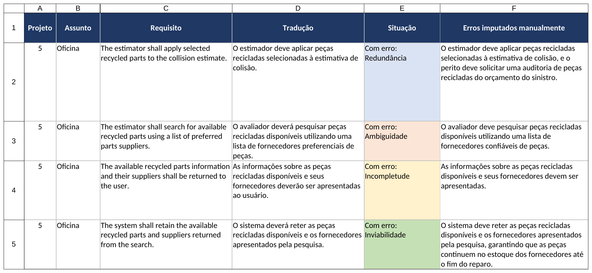

---

## 8. Validação dos defeitos pelas IAs

Cada defeito foi conferido pelas três IAs antes de entrar no gabarito. Um texto só entrou quando todas as IAs que o avaliaram concordaram que ele tinha o defeito da categoria indicada.

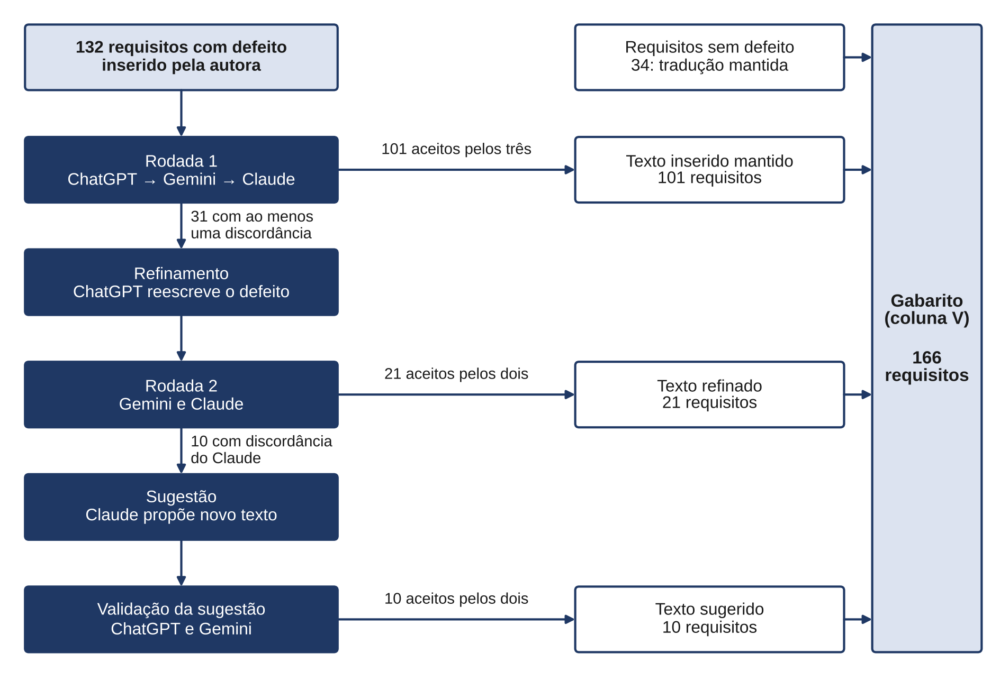

### 8.1 Rodada 1

O ChatGPT, o Gemini e o Claude avaliaram, nessa ordem, os 166 requisitos com a mesma instrução: [prompt 2](prompts/02_validacao_erros_rodada1.md). Para cada requisito com defeito, cada IA respondeu "Concordo" ou "Discordo" e justificou; nos sem defeito, respondeu "Não se aplica". Cada IA recebeu a planilha com as colunas das anteriores, e a instrução pedia que fizesse a própria análise antes de olhar as avaliações já registradas.

| Categoria | ChatGPT: concordo | ChatGPT: discordo | Gemini: concordo | Gemini: discordo | Claude: concordo | Claude: discordo |
| --- | --- | --- | --- | --- | --- | --- |
| Ambiguidade | 33 | 0 | 33 | 0 | 31 | 2 |
| Incompletude | 32 | 1 | 31 | 2 | 23 | 10 |
| Inviabilidade | 33 | 0 | 33 | 0 | 31 | 2 |
| Redundância | 16 | 17 | 16 | 17 | 31 | 2 |
| **Total** | **114** | **18** | **113** | **19** | **116** | **16** |

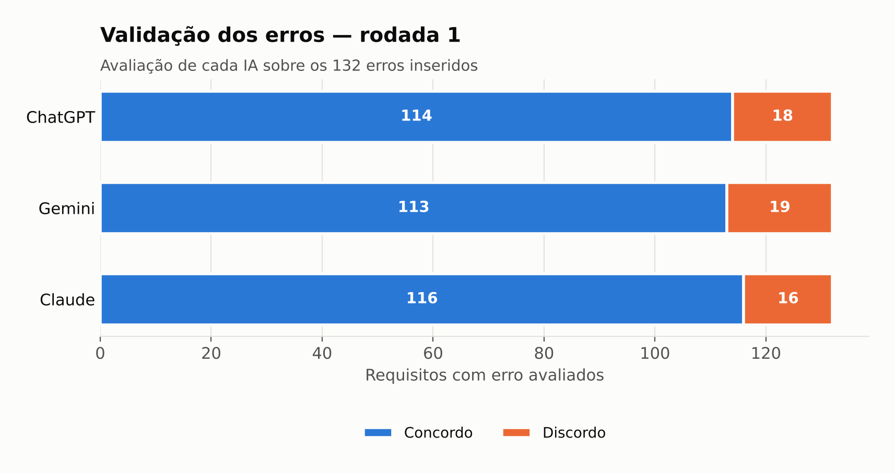

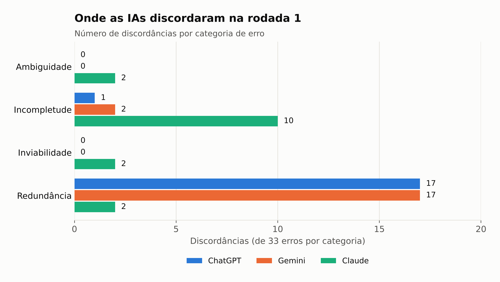

O ChatGPT e o Gemini discordaram sobretudo da redundância. Nos textos em que a autora tinha acrescentado um trecho de outro requisito, eles entenderam que havia uma obrigação nova, e não uma repetição. O Claude discordou sobretudo da incompletude, em geral porque o texto tinha sido cortado antes da ação ou porque a informação retirada podia ser recuperada pelo contexto.

Os três concordaram com **101** defeitos, que ficaram como estavam. **31** receberam ao menos uma discordância.

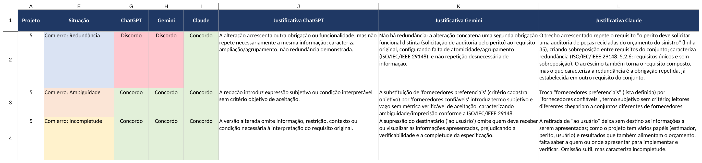

### 8.2 Refinamento

Os 31 defeitos com discordância foram reescritos pelo ChatGPT (coluna M). A instrução usada nesse refinamento não está nesta versão do repositório.

### 8.3 Rodada 2

Os 31 textos refinados foram avaliados pelo Gemini e pelo Claude com a instrução do [prompt 3](prompts/03_validacao_refinamentos_rodada2.md). O Gemini concordou com os 31. O Claude concordou com 21 e discordou de 10 (cinco de incompletude, quatro de redundância e um de ambiguidade).

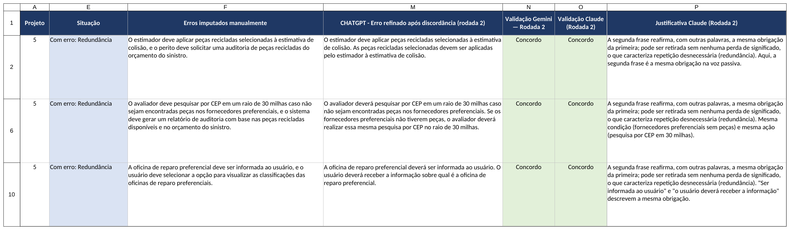

### 8.4 Sugestões do Claude

Para os 10 casos sem consenso, o Claude propôs um novo texto (coluna Q). O ChatGPT e o Gemini avaliaram as sugestões com o [prompt 4](prompts/04_validacao_sugestoes_claude.md) e concordaram com as 10.

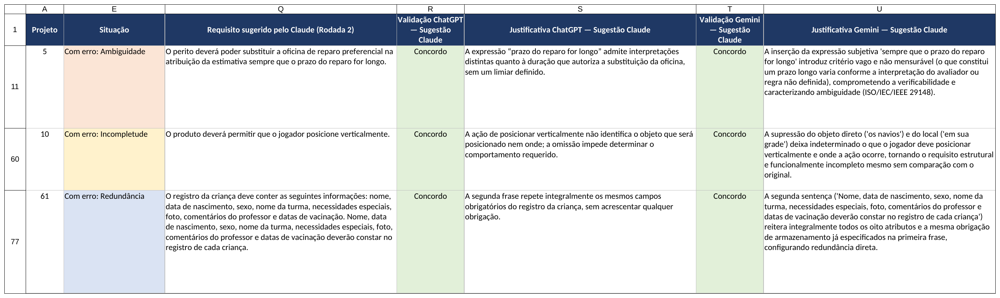

### 8.5 Texto final

A coluna V reúne o texto que será enviado aos modelos nos testes:

| Origem do texto final | Requisitos |
| --- | --- |
| Tradução, nos requisitos sem defeito | 34 |
| Texto inserido pela autora, aceito na rodada 1 | 101 |
| Texto refinado pelo ChatGPT, aceito na rodada 2 | 21 |
| Texto sugerido pelo Claude, aceito pelo ChatGPT e pelo Gemini | 10 |
| **Total** | **166** |

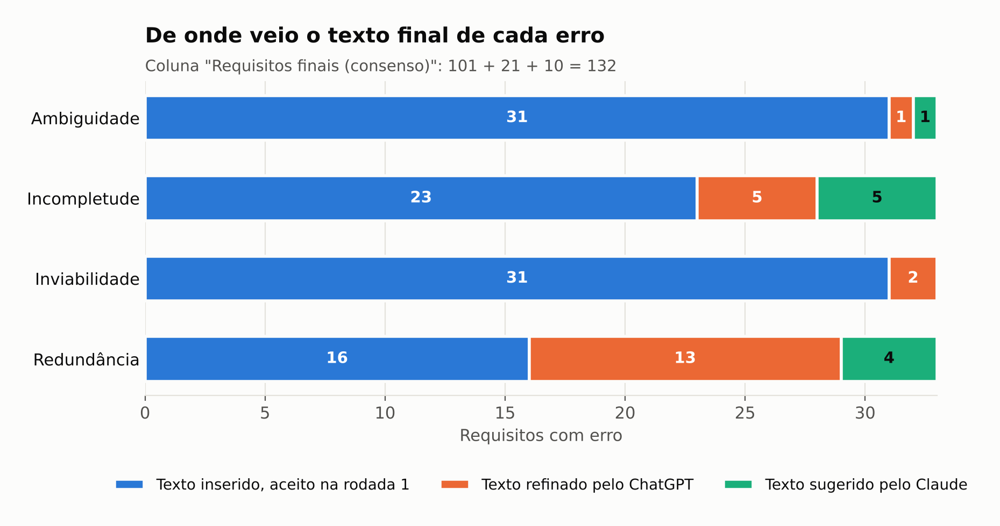

A redundância foi a categoria que mais mudou: no gabarito final, os 33 casos repetem informação dentro do próprio requisito. Em 16, a frase inteira aparece duas vezes; nos outros 17, a mesma obrigação é escrita com outras palavras.

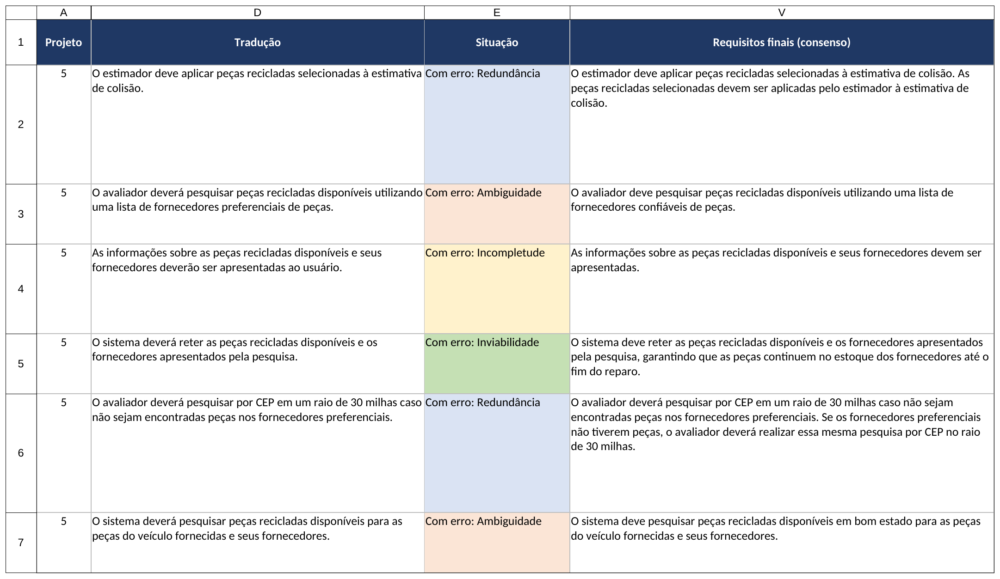

---

## 9. Testes de detecção (a realizar)

Os testes ainda não foram realizados. O protocolo previsto é:

- **Modelos:** ChatGPT, Claude e Gemini, usados pelas interfaces de conversa, com o modelo mais capaz disponível em cada plano. A versão exibida será registrada em cada conversa.
- **Envio:** um projeto inteiro por mensagem, com os requisitos em ordem sorteada e identificadores neutros (R01, R02...). Nenhuma informação indica quais requisitos têm defeito.
- **Conversas:** cada envio numa conversa nova e temporária, sem memória, valendo só a primeira resposta.
- **Repetições:** 5 execuções por modelo, o que dá 60 conversas (4 projetos × 5 execuções × 3 modelos), depois de uma execução piloto com o projeto de batalha naval.
- **Instrução:** a mesma para os três modelos; ainda em elaboração.

Cada resposta será comparada com o gabarito, requisito a requisito:

| Métrica | Cálculo | O que mostra |
| --- | --- | --- |
| Precisão | VP / (VP + FP) | Dos defeitos apontados, quantos existiam |
| Revocação | VP / (VP + FN) | Dos defeitos existentes, quantos foram encontrados |
| F1 | 2 × Precisão × Revocação / (Precisão + Revocação) | Equilíbrio entre as duas |
| Categoria certa | Defeitos encontrados na categoria do gabarito | Acerto na classificação |
| Kappa de Fleiss | (Po − Pe) / (1 − Pe) | Concordância entre as 5 execuções do mesmo modelo |

VP é verdadeiro positivo, FP falso positivo, FN falso negativo e VN verdadeiro negativo. O Kappa será interpretado pela escala de Landis e Koch (1977).

**Linha de base.** Como 132 dos 166 requisitos têm defeito, um modelo que marcasse tudo como defeituoso teria precisão de 0,795, revocação de 1,0 e F1 de 0,886. Os resultados dos modelos devem ser lidos contra essa referência e contra o acerto nos 34 requisitos sem defeito.

A aba RESULTADOS DOS TESTES já está pronta para receber as contagens:

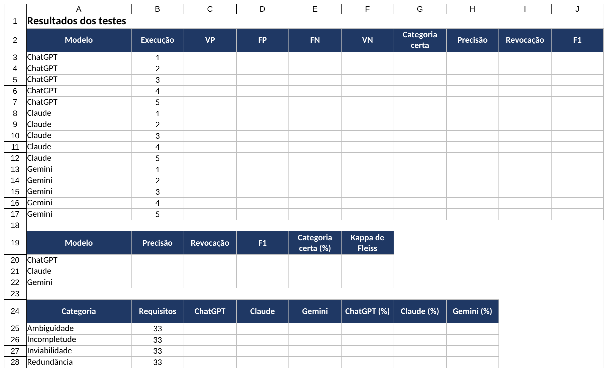

---

## 10. Dicionário de colunas da planilha

Aba **REQUISITOS DO TCC**, uma linha por requisito:

| Coluna | Conteúdo |
| --- | --- |
| A | Projeto (número na Promise+) |
| B | Assunto do projeto |
| C | Requisito original, em inglês |
| D | Tradução (DeepL) |
| E | Situação: "Sem erro" ou "Com erro: categoria" |
| F | Texto com o defeito inserido pela autora |
| G, H, I | Rodada 1: avaliação do ChatGPT, do Gemini e do Claude |
| J, K, L | Rodada 1: justificativas do ChatGPT, do Gemini e do Claude |
| M | Texto refinado pelo ChatGPT (só nos 31 com discordância) |
| N, O | Rodada 2: avaliação do Gemini e do Claude |
| P | Rodada 2: justificativa do Claude |
| Q | Texto sugerido pelo Claude (só nos 10 sem consenso) |
| R, S | Avaliação e justificativa do ChatGPT sobre a sugestão |
| T, U | Avaliação e justificativa do Gemini sobre a sugestão |
| V | Texto final, enviado aos modelos nos testes |

As avaliações são pintadas de verde ("Concordo"), vermelho ("Discordo") ou cinza ("Não se aplica"). O arquivo `dados/gabarito_166_requisitos.csv` traz as colunas principais (projeto, original, tradução, situação, texto final e origem do texto final) para consulta rápida.

As outras abas: **REQUISITOS BASE** (arquivo original), **APENAS FUNCIONAIS** (seção 3), **CONFERÊNCIA** (totais por projeto e por situação, calculados por fórmula) e **RESULTADOS DOS TESTES** (seção 9).

---

## 11. Como reproduzir

É preciso ter Python 3 e a biblioteca `openpyxl`.

```bash
pip install openpyxl

# refaz o funil de seleção (etapas 1 a 5) a partir do arquivo original
python scripts/funil_selecao.py "dados/Promise+.arff"

# recalcula os números das seções 5, 7 e 8 a partir da planilha
python scripts/conferir_numeros.py dados/planilha_do_experimento.xlsx
```

Para conferir o arquivo original: `md5sum "dados/Promise+.arff"` deve retornar `f9227908ff871ccf9a30f53aa61c921a`.

---

## 12. Uso de Inteligência Artificial

Além de serem o objeto de estudo, ferramentas de IA foram usadas no trabalho:

- **DeepL:** tradução dos requisitos.
- **ChatGPT** (ChatGPT Plus, GPT-6 Instant), **Gemini** (Google AI Plus, Gemini 4 Hydrogen) e **Claude** (Claude Pro, Claude Opus 5.5): classificação F/NF, validação dos defeitos, reescrita dos defeitos sem consenso (ChatGPT) e sugestão de novos textos (Claude). As instruções foram elaboradas pela autora com apoio dos próprios modelos; a instrução de validação das sugestões (prompt 4) foi redigida pelo Claude a pedido da autora.
- **Claude:** apoio na organização das planilhas, nas fórmulas e nos scripts, nos gráficos e nas figuras, e na redação e revisão de textos do trabalho e deste repositório.

As decisões de método, a inserção dos defeitos e a conferência dos resultados são da autora.

---

## 13. Histórico das principais decisões

| Data | Decisão |
| --- | --- |
| 17/08/2026 | Orientação: conjunto de 100 a 200 requisitos, mesmo prompt para os três modelos, 5 execuções e métricas de precisão, revocação e F1 |
| 12/09/2026 | Pergunta de pesquisa aprovada pela orientadora |
| 26/10/2026 | Troca da base PURE pela Promise+ e escolha dos quatro projetos |
| 02/11/2026 | Inconsistência substituída por inviabilidade, com base na ISO/IEC/IEEE 29148 |
| 06/11/2026 | Testes passam a ser feitos pelas interfaces de conversa, e não por API |
| 09/11/2026 | Capítulo 3 (método) escrito e norma ISO/IEC/IEEE 29148:2018 consultada |
| 15/11/2026 | Confirmação F/NF por quatro avaliações; conjunto de 166 requisitos; rodada 1 da validação |
| 16/11/2026 | Rodada 2, sugestões e consolidação do gabarito |
| 18/11/2026 | Capítulo 4 (MVP) escrito e publicação deste repositório |

---

## 14. Referências e licença dos dados

- SILVA, B.; NASCIMENTO, R.; RIVERO, L.; BRAZ, G.; SANTOS, R. P. dos; MARTINS, L. E. G.; VIANA, D. Promise+: expandindo a base de dados de requisitos de software Promise_exp. In: Simpósio Brasileiro de Engenharia de Software (SBES), 38., 2024, Curitiba. *Anais* [...]. Porto Alegre: SBC, 2024. p. 291-301. DOI: [10.5753/sbes.2024.3427](https://doi.org/10.5753/sbes.2024.3427).
- Conjunto de dados Promise+, versão v1. Zenodo, 2024. DOI: [10.5281/zenodo.12805484](https://doi.org/10.5281/zenodo.12805484). Licença CC BY 4.0.
- ISO; IEC; IEEE. *ISO/IEC/IEEE 29148:2018*: systems and software engineering: life cycle processes: requirements engineering. 2. ed. Geneva: ISO, 2018.
- FLEISS, J. L. Measuring nominal scale agreement among many raters. *Psychological Bulletin*, v. 76, n. 5, p. 378-382, 1971.
- LANDIS, J. R.; KOCH, G. G. The measurement of observer agreement for categorical data. *Biometrics*, v. 33, n. 1, p. 159-174, 1977.
- SOKOLOVA, M.; LAPALME, G. A systematic analysis of performance measures for classification tasks. *Information Processing & Management*, v. 45, n. 4, p. 427-437, 2009.

O arquivo `dados/Promise+.arff` é distribuído pelos autores da Promise+ sob a licença [CC BY 4.0](https://creativecommons.org/licenses/by/4.0/) e foi incluído aqui sem alteração, com a atribuição acima. As traduções, os defeitos inseridos e as validações são deste trabalho.
